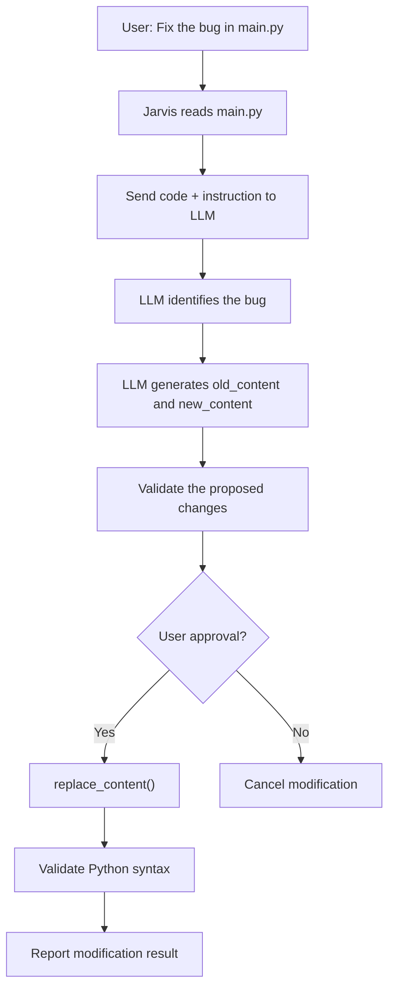

# File Automation Tool
```code
FileAutomationTool
│
├── Creation & Deletion
│   ├── create_files()
│   ├── create_dirs()
│   ├── delete_dir() 
│   ├── delete_file()
│   └── create_project_structure()
│
├── Reading & Writing
│   ├── read_file()
│   ├── write_file()
│   └── append_file()
│
├── Searching
│   ├── search_files_by_filename()
│   ├── search_files_by_extension()
│   └── search_text_in_files()
│
├── Listing & Navigation
│   ├── list_files()
│   ├── list_dirs()
│   └── get_directory_tree()
│
├── File Management
│   ├── rename_file()
│   ├── move_file()
│   └── copy_file()
│   
│
├── Metadata
│   ├── get_file_info()
│   └── path_exists()
│
└── Archive
    ├── create_zip()
    └── extract_zip()
```

